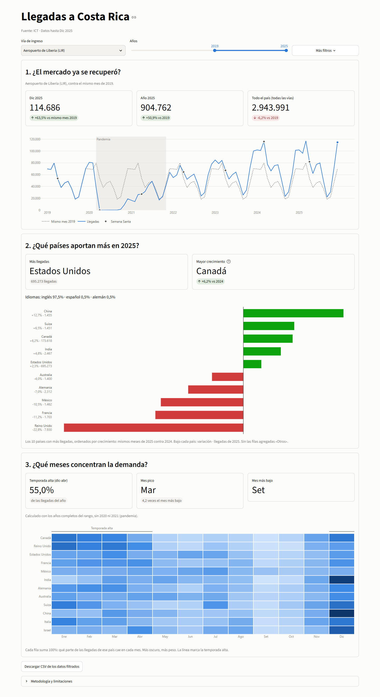
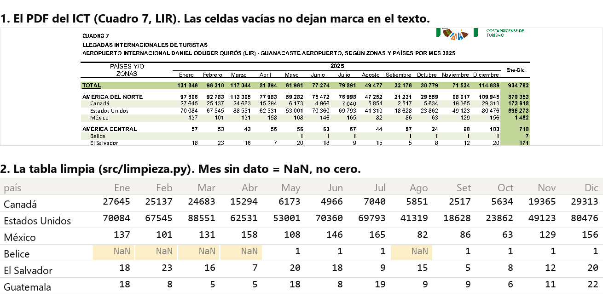

# Turismo CR: de dónde vienen los turistas y cuándo

Dashboard que responde tres preguntas para una cámara de turismo de Guanacaste, con datos públicos del Instituto Costarricense de Turismo (ICT).



| Pregunta | Cómo se responde | Decisión que permite |
|---|---|---|
| ¿Cómo evolucionó la llegada de turistas después de 2020? | Serie mensual vs. mismo mes de 2019 | Saber si el mercado ya se recuperó |
| ¿Qué países aportan más y cuáles crecen más rápido? | Ranking y variación interanual por país | Enfocar promoción e idiomas de atención |
| ¿Qué meses concentran la demanda por mercado? | Mapa de calor país x mes | Planificar personal e inventario |

**Demo:** _pendiente_ · **Video:** _pendiente_

## El reto de los datos

El ICT publica PDF, no Excel. Las celdas vacías no dejan marca en el texto del PDF. Por eso cada número se ubica por su posición x bajo el encabezado de su columna.



Problemas resueltos en `src/limpieza.py` y `src/cargar.py`:

- Separador de miles con espacio: "298 475" se une en 298475.
- Notas al pie pegadas al nombre: "Puerto Rico1" pasa a "Puerto Rico".
- Cuadros de 3 páginas en el anuario.
- Un mismo país escrito distinto entre cuadros: "PANAMA" y "Panamá" quedan como uno.

Cada cuadro suma igual a su fila TOTAL publicada. El informe 2025 y el anuario 2024 coinciden en los 72 meses de 2019-2024. Si el ICT cambia el diseño del PDF, la carga falla con "fuera de columna" en vez de cargar mal.

## Hallazgos

Cifras que muestra la app con LIR (aeropuerto de Liberia, la medida de Guanacaste) y el rango 2019-2025.

1. **Por aire el país ya superó 2019; por tierra no, y eso explica el total.** En 2025 llegaron 2.943.991 turistas por todas las vías, 6,2% menos que en 2019. La vía aérea subió 11,2% y la terrestre cayó 65,3%. Por LIR llegaron 904.762 (+50,9%) y en diciembre 114.686 (+63,5% contra diciembre de 2019).
2. **Estados Unidos y Canadá sostienen a LIR; Europa cae.** LIR creció 2,7% contra 2024. Estados Unidos lidera con 695.273 llegadas (+2,3%) y Canadá es el que más crece entre los 10 principales (+6,2%). Reino Unido bajó 22,8%, y el inglés es el idioma de 97,5% de las llegadas.
3. **La demanda pica en marzo y toca fondo en setiembre.** Con años completos y sin 2020 y 2021, diciembre a abril concentra 55,0% de las llegadas. Marzo tiene 4,2 veces las llegadas de setiembre. Semana Santa cambia de mes (2024 en marzo, 2025 en abril) y mueve las comparaciones de marzo y abril.

## Datos

- **Fuente:** ICT, Informes Estadísticos > Llegadas internacionales. Datos de la Dirección General de Migración y Extranjería.
- **Archivos usados:** informe mensual dic-2025 y Anuario Estadístico de Turismo 2024. Cada cuadro va en `data/raw/archivos.csv` (archivo, página, cuadro, tipo, año, vía, URL y fecha de descarga). Los PDF originales están en `data/raw/` sin modificar.
- **Cobertura actual:**
  - Detalle por país x mes: 2024 y 2025, 73 países en 8 regiones. Vías: todas, aérea, SJO, LIR, terrestre. Marítima solo 2024.
  - Serie mensual publicada 2012-2025 para todas, aérea, SJO, LIR y terrestre. Marítima 2012-2024.
  - Los dos PDF coinciden mes a mes en 2019-2024 para las cuatro vías que comparten.

### Limitaciones

- Detalle por país solo para 2024 y 2025. La pregunta 1 sin filtro usa la serie publicada; con filtro de país arranca en 2024.
- El informe 2025 no trae vía marítima; solo existe para 2024 y antes.
- 2020 y 2021 están afectados por el cierre de fronteras. Las variaciones de esos años no son demanda normal.
- Un mes sin dato queda vacío, no como cero.
- El idioma se asigna por país de residencia y es una aproximación: Canadá cuenta como inglés.
- _Agregar aquí los países o años que falten._

## Modelo

Esquema estrella en DuckDB (`data/processed/turismo.duckdb`):

- `fact_llegadas (fecha, pais_id, via, llegadas)`
- `dim_fecha (fecha, anio, mes, nombre_mes, temporada, semana_santa)`: temporada alta = diciembre a abril; `semana_santa` marca el mes que contiene el Jueves Santo (Pascua menos 3 días)
- `dim_pais (pais_id, pais, region, idioma)`: la región es la zona que usa el ICT; el idioma sale de `IDIOMA_POR_PAIS` en `src/cargar.py` y es el idioma en que conviene atender, no el oficial
- `serie_publicada (fecha, via, llegadas)`: totales mensuales del ICT (cuadros 11-14 y filas TOTAL). Alimenta la pregunta 1 sin filtro de país y sirve para validar

## Correr local

```bash
python -m venv .venv
.venv\Scripts\activate          # Windows
pip install -r requirements.txt

# 1. Poner los PDF del ICT en data/raw/ y listar cada cuadro en data/raw/archivos.csv
python -m src.cargar            # crea data/processed/turismo.duckdb
pytest                          # valida limpieza y totales contra el ICT
streamlit run app.py
```

## Estructura

```
data/raw/            PDF originales del ICT + archivos.csv
data/processed/      turismo.duckdb (se genera)
notebooks/           exploración y hallazgos
src/limpieza.py      PDF del ICT -> tabla larga (sin TOTAL ni subtotales de zona)
src/cargar.py        crea el modelo y carga las tablas
src/consultas.py     SQL parametrizado que usa la app
src/indicadores.py   temporada, acumulados y Semana Santa sobre la serie filtrada
src/estilo.py        paleta, formato español (fmt) y plantilla Plotly
src/graficos.py      las tres gráficas
.streamlit/          tema de Streamlit (colores, barra de herramientas mínima)
docs/img/            captura de la app y recorte del PDF contra la tabla limpia
app.py               Streamlit
tests/               pytest
```

## Pruebas

- La suma de países por mes coincide con la fila TOTAL publicada, en los 5 cuadros.
- El TOTAL de 2025 coincide con la serie 2019-2025 y los totales anuales con el Ene-Dic publicado.
- Un país escrito distinto entre cuadros ("PANAMA" / "Panamá") queda como uno solo.
- No hay duplicados de (fecha, país, vía) ni llegadas negativas.
- Todo país tiene región.
- Un mes sin dato no se convierte en cero.
- La variación interanual da el resultado esperado con datos de ejemplo.
- Todo país de la base tiene idioma. Un país nuevo sin mapear hace fallar la carga y la prueba.
- Los meses de Semana Santa coinciden con la nota del ICT: abril de 2019 a 2023 y 2025, marzo de 2024.
- En LIR 2025 contra 2024: Estados Unidos +2,3%, Canadá +6,2% y Reino Unido -22,8%.
- El ranking excluye las filas "Otros" y un país de 50 a 100 llegadas no gana a uno de 10.000 a 11.000.
